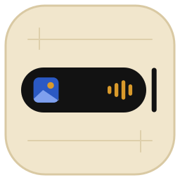
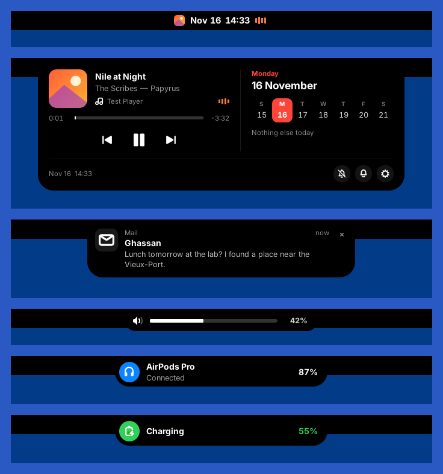

# Cartouche

A Dynamic Island for GNOME. The clock in the middle of the top bar becomes a living pill.



While music plays, the cover and a few bouncing bars sit around the clock. Turn the volume up
and the level slides out of the pill instead of popping up in the middle of the screen. A
notification drops into it instead of a banner. Plug in, connect your headphones, turn on Do Not
Disturb: the island says so, then shrinks back. Rest the pointer on it and it opens up into the
player, your week and next events, your battery and a few switches. A GNOME take on
[Alcove](https://tryalcove.com/) for the Mac.

**[Website with a live demo](https://dabane-ghassan.github.io/cartouche/)**

## Install

```sh
curl -fsSL https://dabane-ghassan.github.io/cartouche/install.sh | sh
```

Then **log out and back in once** so GNOME picks it up. The clock in the top bar is now the
island.

It works on any distro with the GNOME desktop, versions 45 to 51 (Fedora 39+, Ubuntu 24.04+,
Debian 13, Arch). Nothing needs root: everything goes under `~/.local`. To remove it, run
`cartouche uninstall` (or the line above with `sh -s -- --remove` at the end); the clock comes back
exactly as it was.

Or, by hand: download `cartouche.shell-extension.zip` from the
[latest release](https://github.com/dabane-ghassan/cartouche/releases/latest), then
`gnome-extensions install cartouche.shell-extension.zip`.

## Update

```sh
cartouche update
```

Your settings are kept. Then log out and back in once more, because GNOME only loads new code at
login.

## Use

| | |
|---|---|
| Rest the pointer on it | It opens up; move away and it closes |
| Click | Opens it; on a notification, opens the app |
| Swipe down · swipe up | Open · put away what it shows (the notification stays in GNOME's list) |
| Swipe sideways | Next or previous song |
| Middle-click | Closes a notification for good |
| Right-click, or **Super+V** | GNOME's notification list and calendar, as before |
| **Ctrl+Alt+I** | Open or close it from the keyboard |

Opened up, the player has the cover (click it to bring the player's window forward), the
title, a progress bar you can click or drag to seek, and previous, play/pause and next. Next to
it: the week, and your next events today and tomorrow from GNOME's calendar (Evolution, GNOME
Online Accounts). Below: the battery, Do Not Disturb, GNOME's notification list, and the settings.

### What it shows

- **What is playing**, from any player that speaks MPRIS: Spotify, Firefox, Chrome, Rhythmbox,
  Lollypop, Amberol, mpv, VLC… The bars take the colour of the album art. Paused music stays in
  the pill for two minutes. Each new song shows its title and artist in the pill for a moment.
  The pill, the new song and the volume level always stay inside the top bar. The pill can show the artwork
  around the clock (the default), the song title, or just the clock.
- **Volume, screen brightness, keyboard backlight and microphone**, instead of GNOME's pop-up in
  the middle of the screen, as a smooth bar or sixteen segments, with or without the percentage.
  GNOME's other pop-ups (airplane mode, touchpad on or off) show there too.
- **Notifications**, instead of banners. They still land in GNOME's list under the clock, with
  their sound, and Do Not Disturb is respected. Urgent ones stay until you close them; their
  buttons work as in a banner.
- **Charging**, a full battery, and a low battery (at a level you choose, then at 10% and 5%).
- **Headphones and other Bluetooth devices** connecting and disconnecting, with their battery.
- **Do Not Disturb** going on and off.

Each of these can be turned off in the settings (`cartouche settings`, or the Extensions app).

### On the lock screen

What is playing, and volume and brightness, stay on the lock screen, where the island shows the
song title. Notifications, your calendar and the shortcut never do. This can be turned off.

### Out of the way

Over a fullscreen video or game, the island steps aside and GNOME's own pop-ups show as usual.
When GNOME's own menus open from the top bar, the island closes for them.
At rest, the island takes the clock's place in the top bar and your icons are laid out around
it exactly as around the clock, so it never sits on them. On a crowded top bar (a small laptop
screen, many indicators), the pill drops the bars, then the artwork, before it would push an icon
out; they come back when there is room.

## Command

```
cartouche open | close | toggle     open the island up, or close it
cartouche dismiss                   put away what it is showing
cartouche play | next | previous    control what is playing
cartouche state                     what the island is doing, as JSON
cartouche settings                  open the settings
cartouche update | uninstall
```

The same calls are on D-Bus, at `/io/github/dabane_ghassan/Cartouche` on `org.gnome.Shell`
(interface `io.github.dabane_ghassan.Cartouche`).

## Privacy

No account, no analytics, nothing sent anywhere. Album art is read from wherever the player says
it is (a file, or the web address the player gives, as Spotify does), and kept in
`~/.cache/cartouche/art` (the newest 48 pictures).

## How it works

Cartouche is a GNOME Shell extension. The island is one actor above the top bar that morphs
between views, growing with a little overshoot and settling when it shrinks. GNOME's clock
button stays in place but invisible, sized to the pill, so the top bar keeps its usual layout and
its menu and Super+V still work. Volume and brightness
come from GNOME's own OSD manager, notifications from GNOME's own message tray: Cartouche takes
over the one method that would show the pop-up or the banner, on GNOME's object rather than its
class, and gives it back when turned off. Everything else is read from D-Bus: MPRIS for music,
UPower for the battery, BlueZ for Bluetooth.

## Develop

```sh
make install     # install from this checkout
make lint        # syntax, schema and shell checks
make test        # end-to-end tests in a headless GNOME Shell (see tests/README.md)
make dist        # the release files, in dist/
make assets      # redraw the logo and the website's images
```

The tests start a private, headless GNOME Shell, load the extension, and drive it with a virtual
mouse, GNOME's own OSD and notification paths, and a pretend music player, checking over a hundred things
from the clock's text to the lock screen and a clean log.

## Why "cartouche"?

In Egyptian hieroglyphs, a cartouche is the oval drawn around a name, tied off with a line at one
end, so that it stands out from everything around it. Champollion found his way into the Rosetta
Stone by reading the names inside them. This one holds the time, and whatever matters right now.

From the maker of [Manicule](https://dabane-ghassan.github.io/manicule/) and
[Festoon](https://dabane-ghassan.github.io/festoon/). MIT license.
